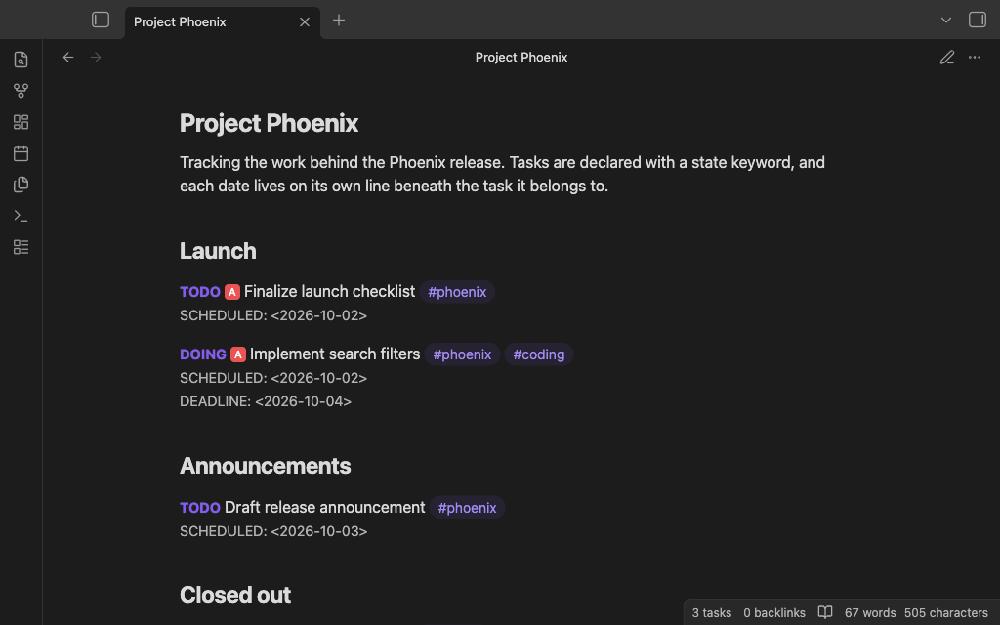
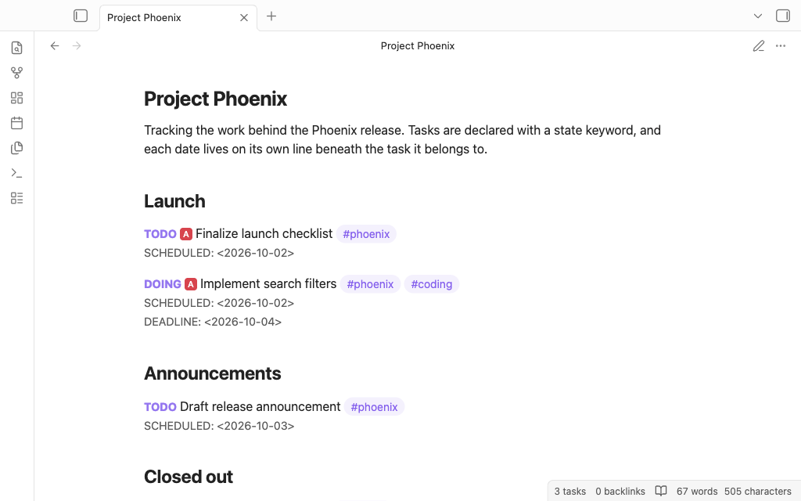

# Reader View

TODOseq keeps tasks interactive in Obsidian's Reader view (also called Reading mode or Preview mode). While you read, click a keyword to change its state, open the context menu, and see the same styling as in the editor.

{.ts-img-full .ts-img-dark}
{.ts-img-full .ts-img-light}

## What You Get in Reader View

With **Format task keywords** enabled, keywords such as `TODO`, `DOING` and `DONE` are bold and use your theme's accent color, and completed tasks are struck through. SCHEDULED, DEADLINE, CLOSED and STARTED lines get their own styling.

Styling stops at the date line: other paragraphs keep your theme's color and size, including markdown rendered by other plugins.

Tasks on heading lines work too, with the keyword sized to the heading.

## Interacting with Tasks

Tasks can be updated without switching to edit mode.

### Click to Cycle States

Click any task keyword to cycle its state: `TODO` becomes `DOING`, then `DONE`. Clicking again continues the cycle.

### Right-Click for Direct State Selection

Right-click a keyword to pick a next state directly, without cycling through the ones in between.

### Checkbox Tasks

With checkboxes, clicking the box checks or unchecks it and the keyword follows: checked is DONE, unchecked is TODO.

## Property Drawers

Task property drawers are shown as quiet metadata. A closed drawer with at least one property has a collapse arrow in the left margin before `:PROPERTIES:`; select the arrow to collapse the entries and `:END:`, and select it again to expand them. Empty and unclosed blocks have no chevron; the disclosure requires a completed drawer with at least one property.

If you do not want task-owned property metadata in Reading view at all, enable **Hide task properties in Reading view** in TODOseq settings. This hides every task-owned property block, including empty, unclosed and otherwise-expanded blocks. The setting is Reading-view-only; it does not change the editor. The drawer stays in the note, and disabling the setting restores the default rendering.

## Code Blocks in Reader View

Code blocks are left alone in Reader view: no keyword styling and no interactive elements, so code examples stay readable and a keyword inside code is never treated as a task.

Code block styling applies only in the editor, and only when that setting is enabled. In Reader view, code blocks are always plain.
