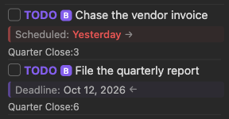
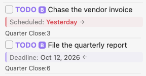

# Warning Periods

A warning period changes when a task becomes visible in the Task List relative to its SCHEDULED or DEADLINE date. A deadline can appear early; a scheduled task can appear late.

The syntax comes from [Org Mode's warning periods](https://orgmode.org/manual/Deadlines-and-Scheduling.html): `-5d` on a deadline starts warnings five days early, and `-2d` on a scheduled item delays it two days. TODOseq follows the same semantics and adds per-task overrides and first-only periods.

## Why Use Warning Periods?

Without one, a task with `DEADLINE: <2026-06-20>` appears only on June 20; with `-5d` it appears from June 15.

Common use cases:

- **Deadline advance notice**: a report due Friday appears from Monday, leaving time to work on it
- **Scheduled delay**: a follow-up task for next week stays out of today's list until closer to the date
- **Recurring tasks with initial grace period**: a weekly review gets 2 extra days on the first occurrence only

## Syntax

Warning periods use the `-Nunit` syntax appended after the date (and after a repeater if present). The unit character determines the time scale:

| Unit | Meaning | Example | Equivalent days |
| ---- | ------- | ------- | --------------- |
| `d`  | Days    | `-5d`   | 5 days          |
| `w`  | Weeks   | `-1w`   | 7 days          |
| `m`  | Months  | `-1m`   | ~30 days        |
| `y`  | Years   | `-1y`   | ~365 days       |

The unit character is case-insensitive — `d`, `D`, `w`, `W`, `m`, `M`, `y`, and `Y` all work.

```markdown
DEADLINE: <2026-06-20 Sat -5d> # Appears 5 days before deadline
SCHEDULED: <2026-06-10 Wed -1w> # Appears 1 week after scheduled date
DEADLINE: <2026-06-20 Sat -1m> # Appears ~30 days before deadline
DEADLINE: <2026-06-20 Sat -1y> # Appears ~1 year before deadline
DEADLINE: <2026-01-01 Wed +1m -3d> # Monthly repeat, 3-day advance notice
```

### First-Only Warning Periods (`--Nunit`)

For recurring tasks, use `--Nunit` (double dash) to apply the warning period only to the first occurrence. Subsequent occurrences ignore the delay:

```markdown
SCHEDULED: <2026-06-10 Wed +1w --2d> # First occurrence delayed 2 days; later weeks on time
DEADLINE: <2026-03-01 Sun +1m --1w> # First month: 1-week advance notice; later months: none
```

The `-Nunit` form (single dash) persists across all occurrences. The `--Nunit` form is removed from the written date line when the task rolls to its next occurrence, so the file and the task list agree.

Advancing a recurring task only rewrites the date that repeats. A one-off SCHEDULED or DEADLINE on the same task is preserved untouched.

## How It Works

- **Deadline** warning periods act as **advance notice** — the task appears N days _before_ the deadline
- **Scheduled** warning periods act as a **delay** — the task appears N days _after_ the scheduled date
- When a task has **both** dates, both warning periods apply and the earlier effective date wins by default

### Tasks with Both Dates

When a task has both SCHEDULED and DEADLINE dates, both warning periods may apply. The **earlier** effective visibility date wins by default. Two [settings](settings.md#ignore-scheduled-delay-when-deadline-is-set) control precedence:

| Ignore Scheduled Delay | Ignore Deadline Advance | Behavior                                       |
| ---------------------- | ----------------------- | ---------------------------------------------- |
| Off (default)          | Off (default)           | Both apply, earlier date wins                  |
| On                     | Off                     | Deadline advance wins; scheduled delay ignored |
| Off                    | On                      | Scheduled delay wins; deadline advance ignored |
| On                     | On                      | Both ignored; raw dates used                   |

**Example** with `SCHEDULED: <June 10 -3d>` and `DEADLINE: <June 20 -5d>`:

| Settings               | Scheduled effective     | Deadline effective        | Effective visibility date | Explanation             |
| ---------------------- | ----------------------- | ------------------------- | ------------------------- | ----------------------- |
| Default (skip neither) | June 13 (10+3)          | June 15 (20−5)            | June 13                   | Earlier of the two wins |
| Skip scheduled instead | June 10 (delay ignored) | June 15 (20−5)            | June 10                   | Scheduled uses raw date |
| Skip deadline instead  | June 13 (10+3)          | June 20 (warning ignored) | June 13                   | Deadline uses raw date  |
| Skip both              | June 10 (raw)           | June 20 (raw)             | June 10                   | Both use raw dates      |

For full details on the formulas and all setting permutations, see [Warning Period Settings](settings.md#warning-period-settings).

## Global Defaults

You can set default warning periods that apply to all tasks in [Settings → Warning Period Settings](settings.md#warning-period-settings):

- **Deadline advance notice (days)**: Default advance notice for all deadlines (0 = disabled)
- **Scheduled delay (days)**: Default delay for all scheduled dates (0 = disabled)

Per-task warning periods (set via `-Nd` syntax) override these defaults. A value of `0` on a specific task explicitly disables the warning period for that task.

## Warning Periods Across TODOseq

Warning periods interact with several TODOseq features:

- **[Settings](settings.md#warning-period-settings)** — Configure global defaults and skip behavior
- **[Task Entry Structure](task-entry.md#warning-periods-advance-notice--delayed-notice)** — Full syntax reference with examples for SCHEDULED, DEADLINE, and recurring dates
- **[Sort Methods](sort-methods.md#note-on-warning-periods)** — Warning periods affect visibility but not sort order
- **[Task List Date Displays](task-list.md#date-displays)** — Warning period arrow indicators (`→` and `←`) show at a glance when a task's visibility is shifted
- **[Date Picker](task-list.md#date-picker)** — Set warning periods via the UI when editing scheduled or deadline dates
- **[Embedded Task Lists](embedded-task-lists.md#warning-period-overrides)** — Override warning period settings per code block with `upcoming-period:`, `scheduled-warning-period:`, `deadline-warning-period:`, and skip toggles
- **[Urgency](urgency.md#warning-periods-and-urgency)** — Warning periods do **not** affect urgency calculations; urgency always uses the raw scheduled and deadline dates

### Visual Indicators

When a task has a warning period set, the task list displays small arrow indicators next to the date:

- **`→` (right arrow)** on a scheduled date indicates delayed notice — the task appears _after_ the scheduled date
- **`←` (left arrow)** on a deadline date indicates advance notice — the task appears _before_ the deadline

The arrows show at a glance that a warning period is active. They also appear in embedded task lists when date badges are enabled.

{.ts-img-detail .ts-img-dark}
{.ts-img-detail .ts-img-light}

## Examples

### Basic Deadline Advance Notice

```markdown
TODO Submit grant proposal
DEADLINE: <2026-07-01 Wed -7d>
```

The task appears in the task list from June 24, giving you a week to prepare.

### Scheduled Task with Delay

```markdown
TODO Follow up with client
SCHEDULED: <2026-06-15 Mon -3d>
```

The task is scheduled for June 15 but doesn't appear until June 18.

### Recurring with First-Only Delay

```markdown
TODO Weekly team standup
SCHEDULED: <2026-06-08 Mon 09:00 +1w --2d>
```

The first occurrence (June 8) is delayed by 2 days (appears June 10). All subsequent weekly occurrences appear on schedule with no delay.

### Overriding Defaults Per-Task

If your global default deadline advance notice is 5 days, you can disable it for a specific task:

```markdown
TODO Urgent fix
DEADLINE: <2026-06-20 Sat -0d>
```

The `-0d` overrides the global default, so the task appears only on June 20.

### Embedded List Override

In an [embedded task list](embedded-task-lists.md#warning-period-overrides), you can override the global settings for just that view:

````txt
```todoseq
search: tag:project1
upcoming-period: 14
deadline-warning-period: 5
```
````

This embedded list uses a 14-day upcoming window and 5-day deadline advance notice, regardless of global settings.
